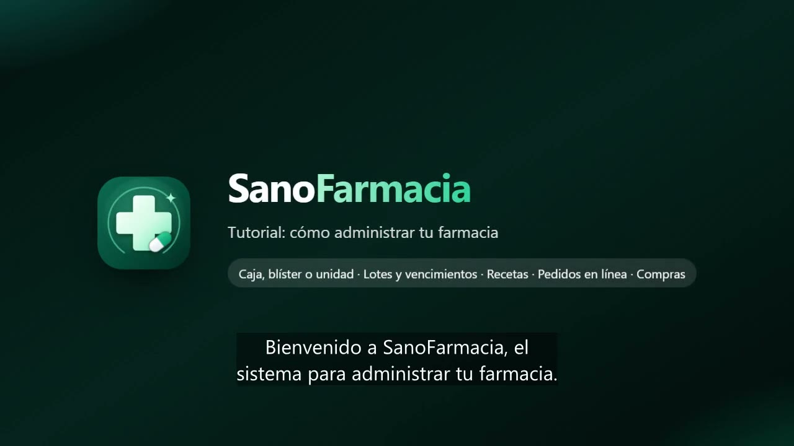

# SanoFarmacia 💊

Software de gestión para farmacias de la línea **Sano** (SanoGym, SanoDental, SanoDoctor, SanoTecnico, SanoGestion, SanoCortes).
PWA instalable (PC, tablet, Android, iPhone) y mundial: el país se elige la primera vez y define moneda,
formas de pago y código de WhatsApp. Opcionalmente trabaja con una segunda moneda (por ejemplo dólares y bolívares).

**Producción:** https://sano-farmacia.web.app · **Credenciales:** `CREDENCIALES_SANO_FARMACIA.txt` (no se sube a git)



## Qué hace

| Módulo | Detalle |
|---|---|
| Vender | Lector de código de barras o búsqueda por nombre / principio activo. Venta por **caja, blíster o unidad** con recargo opcional por fraccionar. Muestra lotes, vencimiento y **equivalentes más económicos** (mismo principio activo y concentración). Alerta de **alergias** del paciente, convenio o seguro, canje de puntos, vendedor, servicios farmacéuticos y varias formas de pago con vuelto (F9). |
| Lotes y vencimientos | Cada entrada queda con su lote y vencimiento; al vender sale primero lo que vence antes (**FEFO**). Vencimientos a 30/60/90/180 días, retiro de lotes vencidos o devolución al proveedor, movimientos y conteo físico con PIN. |
| Recetas y controlados | Libro de recetas (médico, matrícula, paciente, productos y lotes despachados) y libro de controlados/psicotrópicos aparte; antibióticos y controlados retienen receta. Impresión para la inspección y exportación CSV. |
| Pacientes | Ficha con cédula, alergias, enfermedades, convenio, médico tratante, **tratamientos continuos**, mediciones (tensión, glucosa, peso, saturación, colesterol…), compras y recetas. Importar/exportar CSV. |
| Recompras y fidelidad | Avisa cuándo se le acaba la medicina a cada paciente crónico, con el WhatsApp listo. Convenios y seguros por cobrar con estado de cuenta, saldos, cumpleaños y puntos. Tarjeta digital `/tarjeta/CÓDIGO` con QR, puntos y tratamientos. |
| Pedidos en línea | Catálogo público `/pedido/NOMBRE`: el cliente busca, ve disponibilidad y si requiere receta, y pide con delivery o para retirar sin crear cuenta. La farmacia lo acepta, lo prepara, avisa por WhatsApp y lo cobra en un toque. |
| Compras | Sugerido de compra según mínimos y máximos, órdenes por WhatsApp, recepción con lote, vencimiento, costo (promedio ponderado) y nuevo precio, proveedores y **cuentas por pagar** con vencimiento. |
| Caja y facturas | Apertura, gastos/ingresos y cierre con diferencia; facturas con detalle de lotes, receta y convenio; anulación con PIN que devuelve el producto a su lote. |
| Reportes | Ventas y ganancia por día, top por ventas y por rentabilidad, categorías, laboratorios, condición de venta, formas de pago, clasificación ABC, horas pico, valor y cobertura del inventario, pérdidas por vencimiento y ventas por vendedor (con PIN). |
| Consulta de precios | Pantalla tipo kiosco: el cliente escanea y ve el precio por caja, blíster o unidad y opciones más económicas. Salir pide PIN. |
| Demo | 30 minutos sin registro con una farmacia completa de ejemplo (PIN 1234) y recorrido guiado; todo se borra al terminar. |

## Estructura

- `public/` — la app (JavaScript sin compilación + Firebase 10.14.1). `js/views/` una pantalla por archivo; `js/ops.js` reglas de negocio (ventas, lotes, recetas, compras, pedidos); `js/pharma.js` presentaciones, lotes FEFO, condiciones de venta y equivalentes; `js/store.js` datos en tiempo real.
- `firestore.rules` — cada farmacia solo ve lo suyo (`tenants/{uid}`); `cards/{código}` y `shops/{nombre}` se leen solo por clave exacta; `orders` valida cada pedido en línea.
- `scripts/` — aprovisionamiento, pruebas y video tutorial.

## Comandos (desde `scripts/`)

```sh
# Emuladores (en la carpeta del proyecto)
firebase emulators:start --only auth,firestore,hosting --project sano-farmacia   # app en http://127.0.0.1:5121/?emu=1

sh test-emu.sh                 # crea 3 cuentas en el emulador y corre la prueba E2E (46 verificaciones)
node mobile-check.mjs          # sin scroll lateral de 320 px a 1366 px
node prod-smoke.mjs            # prueba rápida en producción (la demo se limpia sola)
node pwa-check.mjs             # instalable en PC y Android

node provision.mjs 20          # crea/actualiza las cuentas en producción
node icons.mjs                 # regenera íconos y logos desde public/assets/logo.svg
node tutorial/make-video.mjs   # graba el video tutorial narrado (voz es-VE)
firebase deploy --only firestore,hosting --project sano-farmacia
```
